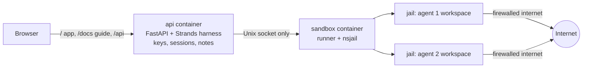

# Echo

Echo is a self-improving agent harness that runs in the browser. Each agent has its own workspace, tools and model, and learns from its runs: it writes and refines its own skills, instructions and notes in its workspace, so it gets better with use.

Every agent works in its own git workspace inside an nsjail jail, so it can run commands, install packages, build and commit without reaching your machine, your network or other agents. People sign in with Microsoft Entra and bring their own model keys (Anthropic, OpenAI, Google or any OpenAI-compatible endpoint). Keys are stored encrypted and never enter a jail.

## How it fits together



- `backend/`: the api. FastAPI on Python 3.12 with `uv`. It runs the agent, keeps users, agents and encrypted keys in SQLite, and serves the browser app and the user guide on the same address.
- `runner/`: the sandbox service. It owns the workspaces and starts a jail per command. It is the only privileged container and holds no secrets.
- `web/`: the browser app. React, TypeScript, Vite, MUI and Monaco, built into the api image.
- `docs/`: the user guide, plain HTML served at `/docs`.

The two containers share only the runner's socket and sit on separate networks, so nothing in a jail has a network path to the api.

## Run it

You need Docker with Compose, permission to run a privileged container, and a Microsoft Entra app registration. The [install guide](docs/install.html) walks through the Entra setup, and [Data and backups](docs/data.html) covers backing up.

```bash
cp .env.example .env      # fill in the Entra ids, client secret and ECHO_SECRET_KEY
docker compose up --build
```

Open http://localhost:8000, sign in, add a model key under Credentials and create an agent. The user guide is at http://localhost:8000/docs and the API reference at http://localhost:8000/api/docs.

Echo listens on 127.0.0.1 only. Do not expose it to a network yet: jails do not have CPU, disk or abuse limits.

## Data

Everything is in two Docker volumes: `echo_sandbox-data` (each agent's workspace, its skills and git history) and `echo_api-data` (the database, chat sessions and notes). They persist until you remove them with `docker compose down -v`. Workspaces are local git repositories and are not pushed anywhere, so back up both volumes if the work matters.

## Develop

```bash
# backend, from backend/
uv sync && uv run pytest

# web, from web/
npm ci && npm test && npm run dev   # Vite on :5173, proxying /api and /docs to the api on :8000

# runner, from runner/
uv run pytest

# full stack tests with real jails, from the repo root
docker compose -f compose.test.yml run --rm api-test
docker compose -f compose.test.yml run --rm sandbox-test
```

`AGENTS.md` has the code conventions and architecture notes, and `CHANGELOG.md` records every change by version. Evals that run real tasks on your own key are in `backend/evals/`.
